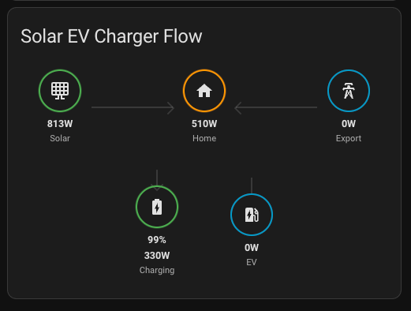
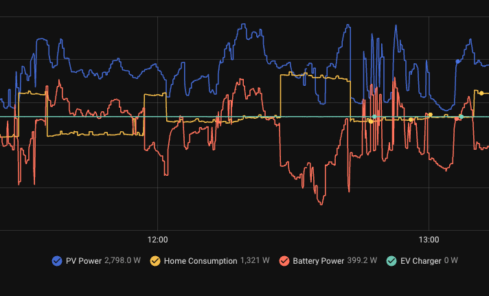
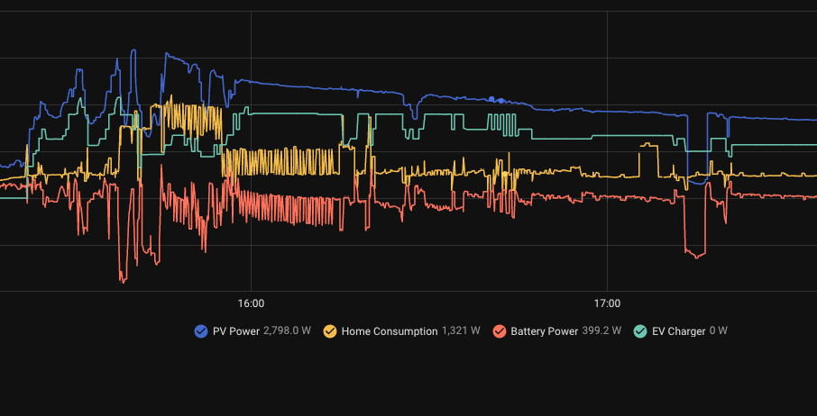

# Solar EV Charger HACS Integration

This Home Assistant integration controls an EV charger's current from surplus solar power. It watches solar production, house consumption, grid power, and the home battery, then drives the charger: a Solax ModBus EV charger directly, or any charger through a `number` current entity (Custom).

## Features

- **Solar surplus control**: Sets the charging current from solar power minus house consumption, plus a configurable battery-discharge allowance.
- **Battery SOC guard**: Stops EV charging while the home battery is below the minimum state of charge.
- **Priority EV mode**: A switch that gives the EV the whole available-power pool instead of sharing it with the battery.
- **Energy flow diagram**: Lovelace card for solar, grid, house, battery, and EV power.
- **Live limits**: Number entities for max current, minimum SOC, max battery discharge, and the smoothing period.
- **Damping**: Rolling average, a wait between current changes, and a 0.5 A deadband. Starting and stopping skip the wait.

## UI Component (Energy Flow Diagram)

This integration includes a custom Lovelace card to visualize the energy flow.



### Manual Setup

Use the automated dashboard, the dashboard blueprint, or add the card yourself.

#### Automated Dashboard (Recommended)

When adding a dashboard in Home Assistant, select **Solar EV Charger** as the strategy. Home Assistant builds a dashboard with the energy flow card and the control switches.

#### Dashboard Blueprint

If your Home Assistant version supports dashboard blueprints, import **Solar EV Charger Dashboard**. It configures the card for you.

#### Manual Card Setup

1. Click **Add Card** → **Manual**.
2. Use this YAML:

```yaml
type: custom:solar-ev-charger-card
entity: sensor.solar_ev_charger_status
```

Replace `sensor.solar_ev_charger_status` with the status sensor from your config entry if the entity id differs.

The card reads `extra_state_attributes` on that sensor: `solar`, `grid`, `consumption`, `battery_power`, `battery_soc`, `ev_power`.

## Configuration

Setup asks for these entities and limits. Power sensors are in watts.

- **Solar Power**: Current solar production.
- **Consumption Power**: Total house consumption.
- **Grid Power**: Export is positive, import is negative. Shown on the energy-flow card.
- **Battery Power (optional)**: Charging is positive, discharging is negative. Shown on the energy-flow card. Solax also uses it to detect battery discharge.
- **Battery SOC (optional)**: Home battery state of charge, in percent.
- **EV Charger Type**: **Solax ModBus integration** or **Custom** (default). The next step depends on it.
- **Max Current**: Upper limit for the charging current. Default 16 A.
- **Voltage entity (optional)** or a fixed voltage. Default 230 V. With Solax, the charger's Charge Voltage is used when this is empty.
- **Minimum battery SOC**: EV charging stays off below this. Default 90%.
- **Max battery discharge for the EV**: Extra power the EV may take from the battery, in kW. Default 1 kW. Stored internally in watts.
- **Smoothing period**: Seconds between current changes. Default 30. Range 0–300.

Second step for **Custom**:

- **EV Charger Power**: Power the charger is using now.
- **EV Charger Control Current**: The `number` entity that sets the charging current, in amps.

Second step for **Solax ModBus integration**: pick the EV charger device from the [Solax ModBus](https://github.com/wills106/homeassistant-solax-modbus) integration. Its Charge Power, Charge Voltage, Charge Current, Charger Use Mode, and Run Mode entities are found automatically, even if you renamed them.

Entries created before 1.3.0 are migrated to **Custom** with the same entities.

The same four limits are also number entities on the integration device (max current, minimum SOC, max battery discharge in kW, smoothing period). Changing a number entity applies immediately in memory and is not written back to the config entry. A reload restores the values from setup.

### Switches and status

| Entity | Role |
| --- | --- |
| Solar EV Charger Enabled | Turns the control loop on or off. |
| Solar EV Charger Solar Only Mode | Off leaves the charger alone (`Manual`). |
| Solar EV Charger Ignore Battery Charging | Gives the EV 100% of the available-power pool (`Priority EV`). |

Status sensor values: `Disabled`, `Manual`, `Priority EV`, `Solar Only`.

## How it works

Available power is in watts:

`Available power = Solar power − House consumption + Max battery discharge`

Example: solar 500 W, house consumption 1000 W, discharge limit 2000 W → 1500 W available.

That value is smoothed with a rolling average over the smoothing period. The EV then receives a share of the smoothed pool:

- SOC below the minimum: charging is stopped (Custom). Solax follows the battery latch rules below.
- Ignore Battery Charging is on, or no SOC entity is configured: 100%.
- SOC equal to the minimum: 60%.
- SOC at or above the midpoint between the minimum and 100% (95% when the minimum is 90%): 90%.
- Between those two SOC points: the share is scaled from 60% toward 90%.

`Target amps = floor(Available power × EV share / Voltage)`

Charging is single-phase. A result below 6 A (IEC 61851) is not used as a partial current. A result above max current is clamped. A difference of 0.5 A or less is ignored, and current changes wait for the smoothing period.

### Custom charger

A start (from 0 A) or stop (to 0 A) is applied immediately. A stop writes 6 A to the current entity, because many chargers do not accept 0 A.

### Solax ModBus charger

- **Start**: Charge Current is written (at least 6 A), then Charger Use Mode is set to **Fast**. A charger left in **ECO** or **Green** is switched to **Fast**.
- **Stop**: Charger Use Mode is set to **Stop** when there is not enough solar.
- Nothing is sent while Run Mode is **Available**, **Unavailable**, **Faulted**, or **Update** (no car or charger not ready).
- **No flapping**: start and stop both happen only after the wish has held for the whole smoothing period. A boiler switching off for a few seconds does not start the car.
- **Battery latch**: if the car is charging and the home battery discharges (below −100 W) with SOC under the minimum for the smoothing period, charging stops and stays off until SOC reaches the minimum again. This avoids the loop "start at 6 A → not enough sun → stop → the freed 6 A look like surplus → start again".
- Below the minimum SOC, a start is allowed only while the home battery is charging (for example 2 kW going into the battery leaves room for 6 A).

The status sensor shows `charger_use_mode`, `charger_run_mode`, and `battery_latch` as attributes.

Grid power and live battery power are not part of this setpoint. They stay on the energy-flow card.

### Optimization Result

**EVC before the integration.** Charging holds a flat rate and ignores solar and house load.



**EVC after the integration.** Charging follows the surplus.



## Installation

1. Install via HACS (custom repository).
2. Restart Home Assistant.
3. Add **Solar EV Charger** from Devices & Services.

## For AI agents

Agent instructions live in [`AGENTS.md`](AGENTS.md). Live checks use the `home-assistant` MCP server from `~/.cursor/mcp.json` (`/api/mcp/homeassistant`: entities, history, logs, config entries).

Do not copy access tokens into this repository.
